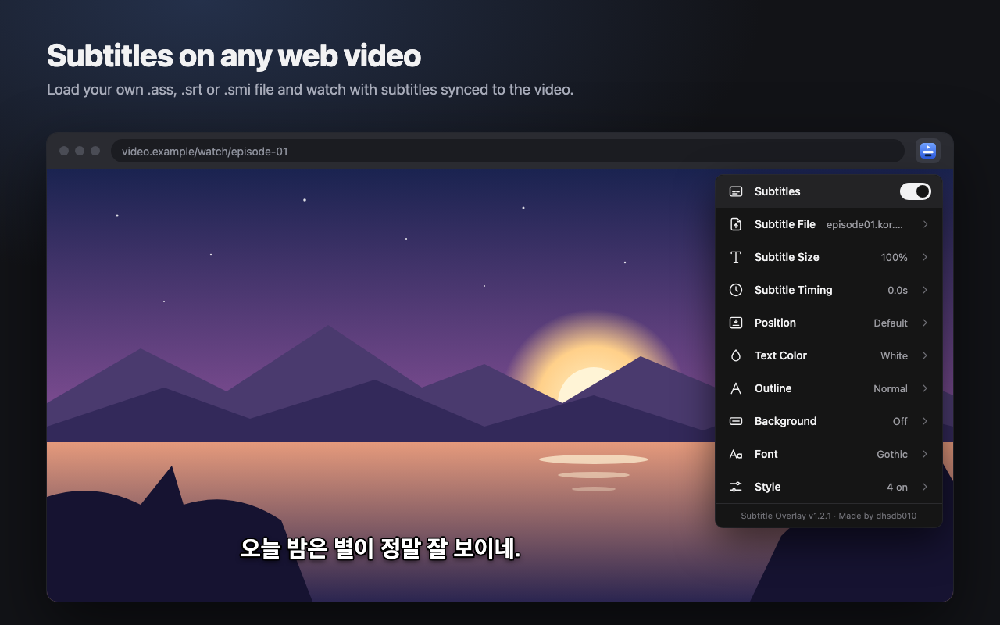

#  Subtitle Overlay (Chrome extension)

Load a `.ass`, `.ssa`, `.srt` or `.smi` subtitle file and show it over any HTML5 video, bottom-center, synced to playback.



## Install
1. Open `chrome://extensions` and turn on **Developer mode** (top right).
2. Click **Load unpacked** and pick this folder.
3. Pin the extension (puzzle icon → pin) and **refresh** the tab with your video.

## Use
1. Click the extension icon → **Subtitle File** (or drag a file onto the popup).
2. Play the video. The subtitles follow the video's own time, so pausing, seeking, and speed changes all stay in sync.
3. If the timing is off, use **Subtitle Timing** in the popup or use the keys on the page:
   - `Alt`+`[` / `Alt`+`]`: subtitles 0.1s earlier / later (add `Shift` for 1s)
   - `Alt`+`\`: hide / show

On macOS, `Alt` is the `Option` key.

## Settings
On/off switch, subtitle size (50–200%), timing, position, text color (presets or a built-in color picker with
eyedropper), outline (thickness + color), background box, font, and a Style page with bold, drop shadow,
colors from the file, sign / top-of-screen text, and drag-to-move.

**Moving subtitles:** drag the subtitle text on the video to put it anywhere. Pick a preset under
**Position** to snap back. Turn off **Style → Drag to move** if you'd rather clicks pass through to the player.

## Version / maker info
`about.json` holds the name, version, maker and changelog; the popup footer shows it.
When you change the version or maker there, also update `version` and `description` in `manifest.json`
(Chrome reads those for `chrome://extensions`).

## Notes
- Text encodings: UTF-8, UTF-16, and legacy Korean EUC-KR/CP949 are detected automatically.
- One subtitle file is loaded at a time and applies to whichever tab plays a video. Turn it off with the toggle when you're done.
- Advanced ASS effects (karaoke, \pos placement, vector drawings, animations) are simplified: dialogue goes to the
  bottom center, and positioned or top-aligned text goes to the top center.
- Fullscreen: subtitles show and can be dragged in fullscreen. When a site tries to fullscreen the bare `<video>`
  (which nothing can be drawn over), the extension fullscreens the video's parent instead and shows the browser's
  video controls there. If that switch isn't possible, it falls back to Chrome's native captions (no dragging).
- `.smi` files with several languages: the Korean track (e.g. `KRCC`) is picked automatically.
- `.srt` supports `<i> <b> <u> <font color>` and `{\an8}` for top placement.
- `sample.ass`, `sample.srt` and `sample.smi` are small Korean test files.

## Privacy
Subtitle Overlay collects no data and makes no network requests. Subtitle files and settings stay in your
browser's local extension storage. See [PRIVACY.md](PRIVACY.md).

## Chrome Web Store package
The store ZIP holds only the extension's own files. From this folder:

```bash
zip -r -X dist/subtitle-overlay-$(python3 -c "import json;print(json.load(open('manifest.json'))['version'])").zip manifest.json about.json background.js content.js fullscreen-main.js settings.js subtitle-parser.js popup.html popup.css popup.js icons
```

Store images and listing text are in `store/` (`store/LISTING.md`, images in `store/out/`).
